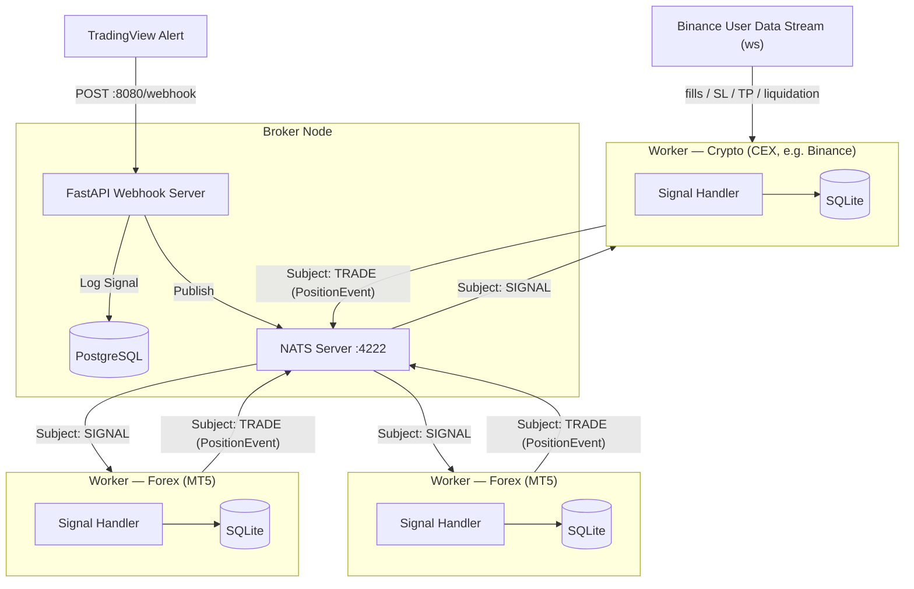

# Architecture

How the worker fits into the trading system, how the repository is laid out, and how each market is hosted at runtime.

## Key concepts

### Market

The `MARKET_TYPE` environment variable defines which trading market the worker operates on:

| Value | Description |
| --- | --- |
| `FOREX` | Foreign exchange — instruments like `XAUUSD`, `EURUSD`, etc. Execution goes through the **MT5** gateway (Windows only). |
| `CRYPTO` | Cryptocurrency — perpetual futures on instruments like `BTCUSDT`. Execution goes through a **CEX** gateway (any OS). |

The market type drives the entire execution path: which gateway is loaded, which environment variables are required, and whether the worker runs as a subprocess (FOREX) or a background thread (CRYPTO).

### Gateway

A gateway is the integration layer between this worker and the actual trading platform. Each market has its own gateway implementation:

| Market | Gateway | Technology |
| --- | --- | --- |
| `FOREX` | **MT5** (`worker/gateways/forex/mt5/`) | MetaTrader 5 terminal via the `MetaTrader5` C extension. Windows-only. Managed as an isolated child process due to GIL constraints. |
| `CRYPTO` | **CEX** (`worker/gateways/crypto/`) | Centralized Exchange via REST + WebSocket. Exchange-agnostic by design — the first concrete implementation is **Binance** Futures (`worker/gateways/crypto/binance/`). Adding a new exchange only requires implementing `BaseExchangeGateway` and registering it in `ExchangeFactory`. |

The selected gateway handles all order execution, position queries, and real-time event streaming (MT5 terminal events for FOREX; exchange user-data WebSocket for CRYPTO). Business logic above the gateway layer is market-agnostic.

## System Architecture



## Project Structure

```text
worker/
├── gateways/            # External trading-platform integrations + shared signal pipeline
│   ├── config.py                 # ExecutionConfig value object (risk/volume params)
│   ├── market_strategy.py        # MarketStrategyFactory + ExecutorBackedMarket / Forex / Crypto
│   ├── processor.py              # BaseSignalProcessor — shared NATS loop (Template Method)
│   ├── reconcile_job.py          # BasePositionReconcileJob — shared broker↔DB reconciler (Template Method)
│   ├── signal_handler.py         # Routes signals to the correct execution flow
│   ├── forex/           # FOREX — platform-agnostic layer + per-platform adapters (mt6 slots in beside mt5)
│   │   ├── base.py                   # BasePlatformGateway (ABC) + SymbolSpec / Tick / PlatformPosition
│   │   ├── factory.py                # PlatformFactory — selects the forex platform
│   │   ├── executor.py               # ForexExecutor (TradeExecutorProtocol)
│   │   ├── lot_sizing.py             # LotSizer — risk-based lot-size math
│   │   ├── stop_validator.py         # StopValidator — SL/TP distance validation
│   │   ├── message_presenter.py      # ForexMessagePresenter (Telegram strings)
│   │   ├── reconcile_job.py          # ForexReconcileJob — missed-close safety-net (ticket/slot matching, two-scan confirmation)
│   │   ├── signal_processor.py       # ForexSignalProcessor — forex hooks over the base
│   │   └── mt5/             # First concrete platform — MetaTrader 5 (Windows only)
│   │       ├── gateway.py            # MT5Gateway (BasePlatformGateway over the MetaTrader5 C extension)
│   │       ├── bridge.py             # MT5 terminal connection lifecycle (initialize/login/shutdown)
│   │       ├── symbol_resolver.py    # SymbolResolver — base → tradeable platform symbol
│   │       ├── close_detector.py     # Terminal-close event scanner (polling)
│   │       └── manager.py            # MT5Manager (alias of WorkerProcessManager)
│   └── crypto/          # CRYPTO — centralized exchanges (CEX); any OS
│       ├── base.py                   # BaseExchangeGateway (ABC) + ExchangePosition
│       ├── executor.py               # CryptoExecutor (TradeExecutorProtocol)
│       ├── factory.py                # ExchangeFactory — selects the CEX
│       ├── message_presenter.py      # CryptoMessagePresenter
│       ├── reconcile_job.py          # CryptoReconcileJob — missed-fill safety-net + manual-position import (two-scan confirmation)
│       ├── signal_processor.py       # CryptoSignalProcessor — crypto hooks over the base
│       └── binance/                  # First concrete exchange
│           ├── gateway.py            # BinanceFuturesGateway (official binance_common transport)
│           └── user_data_stream.py   # BinanceUserDataStream (official-SDK websocket) + parser
├── interfaces/          # Protocol types for dependency inversion
│   ├── db_protocol.py            # Segregated persistence protocols
│   ├── executor_protocol.py      # TradeExecutorProtocol (broker-neutral)
│   ├── mt5_executor_protocol.py  # MT5ExecutorProtocol (legacy alias)
│   ├── mt5_gateway_protocol.py   # Mt5GatewayProtocol (MetaTrader5 surface, used by MT5Gateway)
│   ├── publisher_protocol.py     # MessagePublisherProtocol
│   ├── message_sender_protocol.py # MessageSenderProtocol (notifier send_message contract)
│   └── trade_presenter_protocol.py # TradePresenterProtocol
├── jobs/                # Background polling jobs (daemon threads)
│   ├── cdc_job.py                # PositionCDC — Change Data Capture to NATS TRADE
│   ├── mt5_event_job.py          # MT5EventJob — terminal-close detection (FOREX)
│   └── notification_job.py       # NotificationJob — outbox dispatcher (Telegram retries)
├── schemas/             # Pydantic / dataclass data schemas
│   ├── admin_schema.py           # AdminActionEnum + AdminMessageSchema + Specific action Schema (NATS ADMIN subject)
│   ├── inbox_schema.py           # WorkerConnectedSchema / WorkerConnectedAckSchema / WorkerConnectedErrorSchema (WORKER_CONNECTED request/reply handshake)
│   ├── job_schema.py             # LogAuthorEnum (broker / terminal / exchange)
│   ├── trade_result.py           # TradeResult value object (ok()/fail() factories)
│   ├── metatrader_schema.py      # Back-compat re-export of TradeResult
│   ├── nats_schema.py            # NatsSubjectEnum (SIGNAL, ADMIN, SYSTEM, TRADE)
│   ├── notification_schema.py    # NotificationPlatformEnum / NotificationChannelEnum / NotificationModeEnum
│   ├── position_schema.py        # PositionStatusEnum + PositionEvent / PositionEventType
│   ├── signal_schema.py          # Signal validation schemas
│   └── system_schema.py          # SystemActionEnum + SystemSchema envelope + CryptoLeverageInitSchema (NATS SYSTEM subject)
├── services/            # Infrastructure services
│   ├── db_service.py             # Persistence facade (positions, logs, outbox)
│   ├── nats_service.py           # NATSSubscriber & NATSPublisher (over the NatsClient lifecycle)
│   └── notification_service.py   # TelegramNotification + OutboxNotifier wrapper
├── db/                  # SQLite persistence layer
│   ├── connection.py             # Connection factory
│   ├── repository.py             # SQL + gateway-neutral column ↔ app-domain mapping
│   └── schema.py                 # Table DDL (gateway-neutral columns)
├── utils/               # Shared utilities
│   └── logging.py                # Structured logging helpers
├── app.py               # Application factory, FastAPI lifespan
├── context.py           # WorkerContext — market-agnostic services (DB, notifiers, outbox)
├── logger.py            # Structured logging configuration
├── main.py              # Application entry point
├── market.py            # Gateway orchestrators (FOREX=process, CRYPTO=thread) + worker entry points + factory
├── nats_client.py       # NatsClient — single NATS connection lifecycle in a daemon thread
├── process_manager.py   # WorkerProcessManager — generic subprocess supervisor
├── worker_runtime.py    # run_worker() — shared child-process bootstrap
└── settings.py          # Environment & app configuration (grouped nested settings + per-market validation)
```

## Process Lifecycle & Watchdog

How the worker is hosted depends on the market (`create_market_orchestrator`):

- **FOREX** — a child **process** (the parent FastAPI process never loads the MT5 C extension), supervised by a watchdog:

  ```text
  FastAPI (parent)
    └── GatewayProcessOrchestrator (FOREX)
          ├── WorkerProcessManager.start()  — spawns child process
          ├── Watchdog task                 — checks every 10 s (WATCHDOG_INTERVAL)
          │     └── if child died → WorkerProcessManager.restart()
          └── WorkerProcessManager.stop()   — on FastAPI shutdown
  ```

- **CRYPTO** — no GIL isolation needed (pure-Python gateway), so it runs in a background **thread** under the FastAPI app (`ThreadGatewayOrchestrator`, same watchdog/restart contract as FOREX), launched the same way via `make start`.

Daemon threads running alongside the NATS message loop:

| Thread | Markets | Interval | Purpose |
| --- | --- | --- | --- |
| `forex-health` | FOREX | 15 s (`MT5_HEALTH_INTERVAL`); 15 min while market closed | Checks MT5 connection; sends Telegram alert on disconnect/reconnect, and relaunches/restarts the terminal when needed. Parks the connection over the weekend-closed window (see [FOREX weekend handling](forex.md#forex-weekend-market-closed-handling)) |
| `MT5EventJob` | FOREX | 5 s; paused only while the terminal connection is parked | Detects terminal-side position closes (SL/TP/Stop-Out/manual) |
| `binance-user-stream` | CRYPTO | push | Websocket user-data stream → exchange-side fills / SL / TP / liquidation |
| `forex-reconcile` | FOREX | 60 s; paused only while the terminal connection is parked | `ForexReconcileJob` — polls live platform positions; reconciles DB-open rows that match no live ticket/slot on two consecutive scans (missed-close safety net, incl. a TP1 partial that closed the whole position) |
| `crypto-reconcile` | CRYPTO | 45 s | `CryptoReconcileJob` — polls live positions; reconciles DB-open rows that are exchange-flat on two consecutive scans (missed-fill safety net) and imports exchange-open positions untracked in the DB (manual opens) on two consecutive scans |
| `PositionCDC` | both | 2 s | Publishes `PENDING` position rows to NATS `TRADE` subject |
| `NotificationJob` | both | 1 s | Drains the `notifications` outbox and dispatches Telegram messages (with exponential-backoff retries) |

All threads share the same `stop_event` — a `multiprocessing.Event` for FOREX, a `threading.Event` for CRYPTO — and exit cleanly when it is set.
