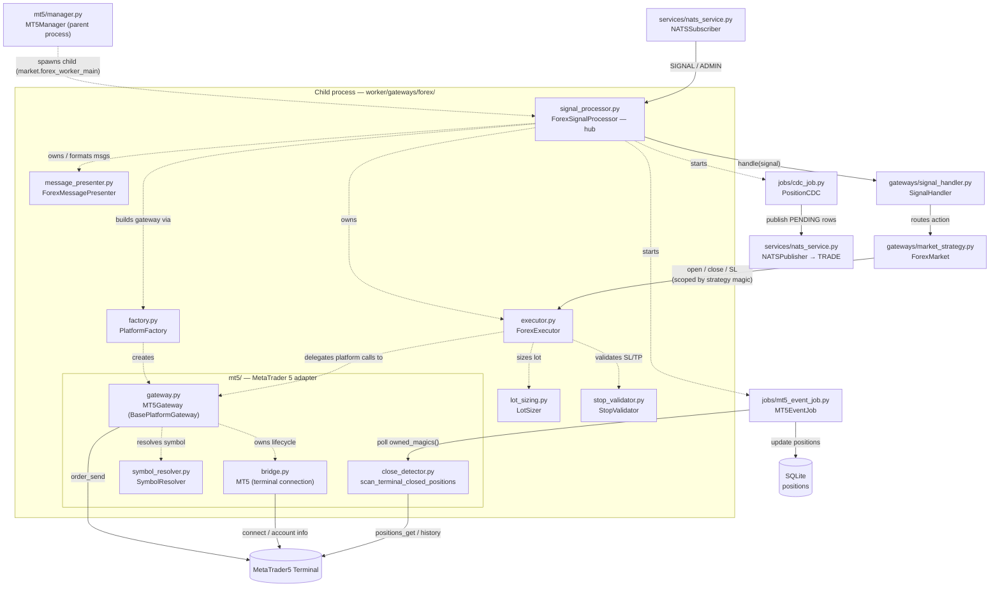

# FOREX (MetaTrader 5)

The FOREX gateway: module flow, the order-send retry, the executor primitives and weekend handling. FOREX runs on **Windows only**.

## FOREX Gateway Module Flow (`worker/gateways/forex/`)

How the FOREX files wire together at runtime. `ForexSignalProcessor` is the hub: it builds the platform gateway via `PlatformFactory` (today an `MT5Gateway` — the **only** MT5-coupled code), wraps it in a platform-agnostic `ForexExecutor` (with `LotSizer` + `StopValidator`), formats messages via `ForexMessagePresenter`, and starts the background jobs. The `MT5Gateway` owns the terminal connection (`bridge`) and symbol resolution (`SymbolResolver`). The handler and market strategy are market-agnostic and shared with CRYPTO. Solid arrows are the live signal path; dotted arrows are composition (who builds/owns whom).

### Busy trade context — `order_send` retry

The terminal serialises every trade request through a single **trade context**. A request that arrives while another one is still in flight is refused outright rather than queued, and the refusal reads `Trade context is busy` (the server-side sibling is retcode `10024` *Too many requests*). It says nothing about the order: the identical request succeeds once the context frees up. Two signals landing together — a `TP1` partial and the breakeven SL move that follows it, or two symbols filling on the same tick — hit it routinely.

`MT5Gateway._send_order_request` therefore wraps **every** `order_send` (entry, close, SL update) in a bounded retry with a sleep between attempts: **4 attempts**, delay **0.3 s doubling** (0.3 → 0.6 → 1.2, ~2.1 s at worst). The condition is matched on the terminal's own wording as well as on the retcode, because it arrives by two routes — a rejected result carries it in `comment`, while a request the terminal refused to send at all returns `None` and leaves it in `last_error()`.

The budget is deliberately small: an entry is a market order priced off the live quote, so retrying for seconds would fill it at a price the signal never meant. Once the budget is spent the refusal is surfaced as the failed `TradeResult` it now really is. Anything that is *not* a busy context — `10019` *No money*, `10014` *Invalid volume*, `10016` *Invalid stops* — is a verdict on the request and is returned on the first attempt, unretried. There is no setting to tune; the attempt count and delay are module constants next to the existing deal-lookup budget in `worker/gateways/forex/mt5/gateway.py`.

## ForexExecutor Primitives (`worker/gateways/forex/executor.py`)

`ForexExecutor` implements the broker-neutral `TradeExecutorProtocol` (the same surface `CryptoExecutor` provides), delegating every platform call to its injected `BasePlatformGateway`:

| Method | Used By |
| --- | --- |
| `open_position(signal)` | Entry (Group 1) |
| `partial_close_position(symbol, close_volume, position_ticket?, strategy?)` | TP1 (Group 2) |
| `update_position_sl(symbol, new_sl, position_ticket?, strategy?)` | TP1 breakeven update |
| `close_all_positions(symbol, reason, strategy?)` | Full exit (Group 3) & broker FLAT |
| `close_single_position(pos, reason)` | Admin FLAT — closes one position by position object |
| `get_open_positions(symbol, strategy?)` | Pre-flight guard in all groups |
| `get_all_open_positions(strategy?)` | Admin FLAT — all positions, by strategy |
| `convert_quantity_to_lots(symbol, quantity)` | Entry & TP1 volume calc |
| `normalize_volume(symbol, volume)` | Rounds/clamps volume to broker lot step & limits |

Risk-based entry sizing (`calculate_lot_size`) and lot-step rounding live in the `LotSizer` collaborator; `_resolve_entry_volume` invokes it internally during `open_position`.

## FOREX weekend market-closed handling

The FOREX market is closed from **Friday 22:00 UTC to Sunday 22:00 UTC**, when the broker's trade server is offline for its weekly maintenance. During this window MT5 legitimately reports "disconnected" — it is **not** a crash, and reconnecting cannot succeed until the market reopens. Left unchecked, the `forex-health` thread would treat it like a weekday outage and hammer the server every 15 s (up to 15 reconnect attempts, then `taskkill terminal64.exe` + relaunch + 15 more), flooding the logs and Telegram all weekend.

Only `forex-health` is driven by the calendar (`is_market_closed()` in `worker/settings.py`, `True` inside the Fri 22:00 → Sun 22:00 UTC window). The two close-detection jobs are driven by the **connection** instead:

| Thread | While the market is closed |
| --- | --- |
| `forex-health` | Closes the MT5 connection **once** (`gateway.close()`), sends a single **"Market Closed"** Telegram notice, then idles at `MT5_HEALTH_INTERVAL_WEEKEND` (default 15 min) — no reconnect attempts, no terminal relaunch — until the market reopens. |
| `MT5EventJob` | Keeps its 5 s polling **while the terminal is still connected**, and only pauses (at the 15-min cadence) once `forex-health` has parked the connection — a closed connection makes `positions_get()` return `None`, so without that it would warn on every scan. |
| `forex-reconcile` | Same rule: normal 60 s cadence while connected, 15-min idle once the connection is parked. |

> **Why not gate the close detectors on the calendar too?** Because a broker's **24/7 instruments** — crypto CFDs such as `BTCUSD` — trade straight through the FOREX weekend window. The terminal stays up (the health thread parks it only at its *next* check, up to 15 min in), signals still fill, and positions can still be closed by hand in the terminal. Gating on `is_market_closed()` made both detectors sleep through exactly that: a manual weekend close was never reported, the row stayed `OPENED`, and it blocked every later signal on the symbol until an operator sent an ADMIN FLAT. Connectivity is the only state that actually makes `positions_get()` meaningless, so it is the only thing that gates a scan.

On **reopen** (Sunday 22:00 UTC = Monday 05:00 UTC+7) the first health check reconnects through the normal path and emits the usual *reconnecting → connected* Telegram pair; both jobs resume their normal cadence and catch up on anything that fired while the connection was parked (`MT5EventJob` still holds the pre-park `seen_tickets`, so a close during the window surfaces on the first scan after reconnect). Open-market behaviour is otherwise unchanged — a genuine disconnect still triggers the full aggressive relaunch/reconnect path immediately.

The window and cadence are module constants in `worker/settings.py`:

| Constant | Default | Meaning |
| --- | --- | --- |
| `MARKET_CLOSE_HOUR_UTC` | `22` | Friday: market is closed at/after this UTC hour |
| `MARKET_OPEN_HOUR_UTC` | `22` | Sunday: market reopens at/after this UTC hour |
| `MT5_HEALTH_INTERVAL_WEEKEND` | `900` (15 min) | Health-check / poll cadence while the market is closed |

> **DST note:** `22:00 UTC` matches the New-York close (17:00 ET) in winter. During northern-hemisphere summer the market opens/closes an hour earlier — set both hour constants to `21` if your broker follows it.
